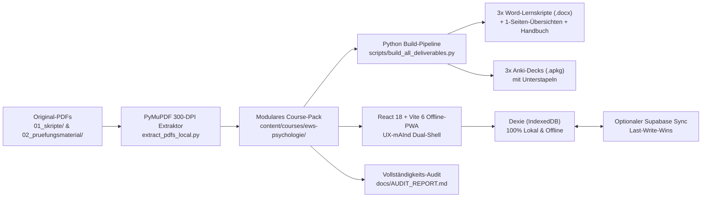

# System-Architektur (`ARCHITECTURE.md`)

## 1. Leitprinzipien
Das **EWS-Psychologie Lernstudio** ist eine lokal-autarke, offline-fähige Dual-Device-Lernplattform (16:10 HiDPI-Windows-Laptop + natives iPhone-PWA-Erlebnis), die exakt auf dem **UX-mAInd Design-System** (`@radix-ui/*` über `ui.jsx`, `StudioPrefsProvider.jsx`, `studio_complete_theme.css`, `vaul`, `cmdk`, `sonner`, `@xyflow/react`) aufbaut und **keinerlei externen KI-/Cloud-API-Key** benötigt.

## 2. Schichtenaufbau
1. **Lokale Extraktions- & Export-Pipeline (`scripts/` & `03_ux_maind_design_paket/`)**:
   - `extract_pdfs_local.py`: Verlustfreie Extraktion aller 263 Skriptseiten + 77 Prüfungs-/Leitfadenseiten inkl. Fettdruck, Kursivschrift, Unterstreichungen (`Empirischer Befund`) und aller 79 Originalgrafiken in 300 DPI.
   - `build_all_deliverables.py`: Führt die JSON-Module zusammen, rendert 300-DPI-Schaubilder (`Pillow`), erzeugt die farbcodierten `.docx`-Skripte (`python-docx`) sowie die `.apkg`-Decks (`genanki`) und spiegelt sie nach `public/exports/`.
   - `audit_completeness.py`: Automatisierter Vollständigkeitsabgleich gegen alle 3 Original-PDFs (`docs/AUDIT_REPORT.md`).
2. **Modulare Course-Pack-Schicht (`content/courses/<course-id>/`)**:
   - Strikte Datentrennung von der UI: Alle fachlichen Einheiten, FSRS-Karten, Prüfungssätze, Operatoren, Verwechslungspaare und Wissensgraph-Knoten liegen als validierte UTF-8-JSON-Dateien vor.
3. **Fachlogik-Engines (`src/lib/`)**:
   - `examScoring.js`: Bayerische Wahlformat-Auswertung (1 Pkt. SC, 4×0,5 Pkt. MC ohne Minuspunkte, Satzlimit-Zähler inkl. Abkürzungsschutz, Operatoren-Prüfung, 75-%-Offen-Validierung).
   - `fsrsEngine.js`: `ts-fsrs` Algorithmus mit sanftem Tages-Cap gegen Überfälligkeits-Berge nach Pausentagen und Priorisierung von Verwechslungspaaren.
   - `adaptivePlanner.js`: 32-Minuten-Kern-Etappe (Sofa-Start -> 1-Seiten-Ankerblatt -> FSRS -> Prüfungs-Transfer), +12-Min.-Bonus-Etappen, individuelle Bezugsnorm (Rheinberg) und NotebookLM-Prompt-Generator.
   - `gamificationEngine.js`: Nicht-strafende Kompetenz-Gamification (XP, 6 Stufen, konzentrische 3-Tagesringe mit Tagesform-Schalter `Sanft 15m` / `Normal 32m` / `Flow 50m`, wachsender botanischer Atelier-Garten, Meilenstein-Abzeichen und automatische Pausen-Schutzschilde).
   - `learnerIntelligence.js`: Mitlernende Lern-DNA & Prüfungs-Prognose (misst reales Lerntempo je Einheit, plant 8 Puffertage vor dem Februar-Termin ein und generiert persönliche Schwachstellen-Podcast-Prompts).
   - `calendarExport.js` & `customCourseBuilder.js`: 7-Tage-Wochenstreifen, RFC-5545 `.ics`-Export (Apple/Google Calendar) sowie In-App-Baukasten für beliebige weitere Studienfächer inkl. lokalem 1-Klick Notiz-zu-Ankerblatt-&-Karten-Konverter.
   - `db.js` & `syncEngine.js`: `Dexie` v2 Multi-Profil-Speicher (ihr Hauptprofil `profile-main` ist fest mit `isProtected: true` geschützt; zusätzliche Profile z. B. für Christian sind 100 % isoliert) + Google-Account OAuth (`signInWithOAuth`) & Timestamp-Sync via Supabase Free Tier.
4. **Adaptive Dual-Shell UI (`src/design/`, `src/views/`, `src/components/`)**:
   - **PC / 16:10 HiDPI (`>= 960px`)**: Ruhige Seitenleiste, `Ctrl+K`-Befehlspalette, 2-Spalten-Bento-Ankerblätter mit Vektor-SVGs (`VisualDiagramSvg.jsx`), blendfreier Dark-Mode-Rahmen für weiße PDF-Originalgrafiken und großer `@xyflow/react`-Wissensgraph mit Seiten-Inspektor.
   - **iPhone PWA (`< 960px`)**: `viewport-fit=cover`, Safe-Areas, 0 px horizontaler Overflow, fixierte Frosted-Glass-Bottom-Navigation, `vaul`-Bottom-Sheets, `>= 44px` Touch-Buttons, `16px` Inputs und `navigator.mediaSession` Sperrbildschirm-Audioplayer.
